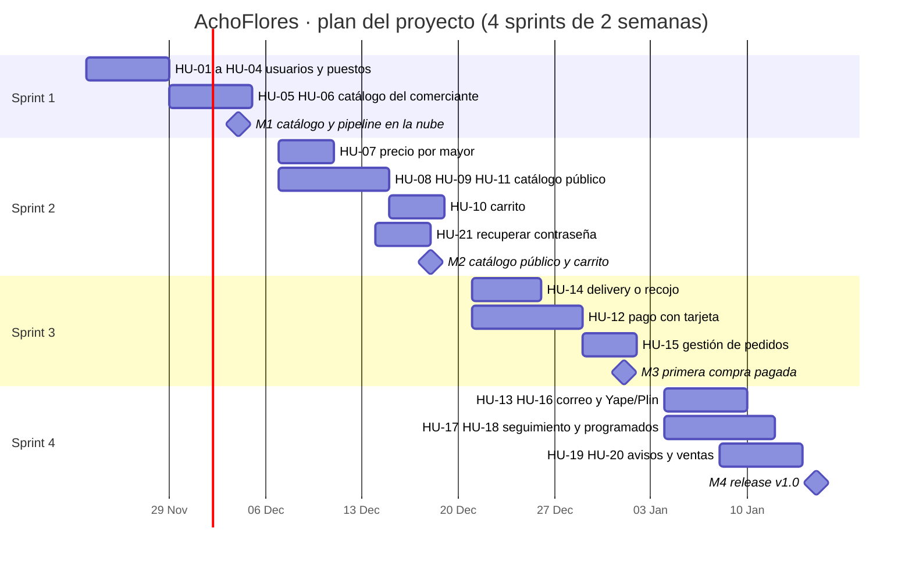
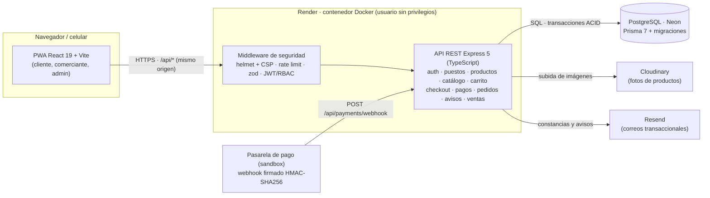

# AchoFlores — Informe final del proyecto

**Caso:** Mercado de Flores de Acho (Rímac, Lima) · **Autor:** David Bravo Ocampo · **Fecha:** 22 de noviembre de 2026

| Recurso | Enlace |
|---|---|
| Repositorio | https://github.com/d-a-b-o/AchoFlores |
| Proyecto Jira (Scrum) | https://dbravoo.atlassian.net/jira/software/projects/ACF/boards/38 |
| Pipeline CI/CD | https://github.com/d-a-b-o/AchoFlores/actions |
| Hallazgos de seguridad | https://github.com/d-a-b-o/AchoFlores/security |
| Solución desplegada (producción) | https://achoflores.onrender.com |
| Entorno de pruebas (staging) | https://achoflores-staging.onrender.com |

---

## 1. Resumen

El problema del Mercado de Acho es de **canal**: vende a precio mayorista, pero solo a quien llega físicamente al Rímac. **AchoFlores** es un marketplace web multivendedor (PWA usable desde el celular) donde cada puesto publica su catálogo y recibe pedidos con pago en línea y delivery en Lima Metropolitana.

Resultado de los 4 sprints:

- **87 story points** entregados en 4 sprints (velocidad 22 · 23 · 18 · 24), 21 historias terminadas, 3 en el Product Backlog para versiones futuras.
- **143 pruebas automatizadas** en el pipeline (104 de API contra PostgreSQL real y 39 de frontend), con 96 % de cobertura de líneas en la API.
- **6 controles de seguridad** integrados en el pipeline (ESLint security, CodeQL, npm audit, Dependency Review, Gitleaks, Trivy) más DAST con OWASP ZAP y pruebas de humo contra el entorno desplegado. Todos detuvieron o corrigieron al menos un problema real durante el proyecto (§7.3).
- Estrategia de ramas `main` / `develop` / `feature/*` con **23 Pull Requests**, 4 releases (v0.1.0 → v1.0.0) y commits con Conventional Commits y la clave de Jira.

---

## 2. Product Backlog en Jira

Proyecto **ACF** (Jira Software, Scrum). Cada historia tiene épica, formato *Como/Quiero/Para*, criterios *Dado/Cuando/Entonces*, **story points** (campo *Story point estimate*) y **prioridad MoSCoW** (campo *Priority* + etiqueta).

### 2.1 Técnicas de estimación y priorización

- **Planning Poker** con Fibonacci (1, 2, 3, 5, 8, 13). Historia de referencia: HU-02 «Iniciar sesión» = 3 SP. Si los votos difieren en más de dos valores, explican quienes votaron el mínimo y el máximo y se vuelve a votar.
- **MoSCoW** mapeado al campo *Priority*: Must = Highest · Should = High · Could = Medium · Won't = Lowest.

### 2.2 Épicas

| Clave | Épica | Objetivo de negocio | Historias |
|---|---|---|---|
| ACF-1 | EP-01 Gestión de usuarios y acceso | Identidad confiable y protección de datos personales (Ley N.º 29733) | HU-01, 02, 03, 21 |
| ACF-2 | EP-02 Catálogo del comerciante | Digitalizar la oferta sin exigir conocimientos técnicos | HU-05, 06, 07 |
| ACF-3 | EP-03 Exploración y carrito | Llegar a clientes que no pueden ir al mercado y subir el ticket promedio | HU-08, 09, 10, 11, 23 |
| ACF-4 | EP-04 Pagos en línea | Cerrar la venta a distancia con pagos seguros y trazables | HU-12, 13, 16, 24 |
| ACF-5 | EP-05 Pedidos y delivery | Entregar flor fresca a tiempo y vender por adelantado en fechas pico | HU-14, 15, 17, 18, 22 |
| ACF-6 | EP-06 Administración y analítica | Ordenar el mercado digital y dar datos de demanda | HU-04, 19, 20 |

### 2.3 Historias de usuario

| Jira | HU | Historia | Épica | SP | MoSCoW | Sprint |
|---|---|---|---|---|---|---|
| ACF-7 | HU-01 | Registrarme como cliente con correo y contraseña | EP-01 | 3 | Must | 1 |
| ACF-8 | HU-02 | Iniciar sesión según mi rol | EP-01 | 3 | Must | 1 |
| ACF-9 | HU-03 | Registrar mi puesto del mercado | EP-01 | 5 | Must | 1 |
| ACF-10 | HU-04 | Aprobar o rechazar puestos registrados | EP-06 | 3 | Must | 1 |
| ACF-11 | HU-05 | Publicar un producto con foto, precio y stock | EP-02 | 5 | Must | 1 |
| ACF-12 | HU-06 | Editar o desactivar productos y actualizar stock | EP-02 | 3 | Must | 1 |
| ACF-13 | HU-07 | Definir precio por docena o por mayor | EP-02 | 3 | Should | 2 |
| ACF-14 | HU-08 | Ver el catálogo de todos los puestos | EP-03 | 5 | Must | 2 |
| ACF-15 | HU-09 | Buscar y filtrar por flor, ocasión y precio | EP-03 | 5 | Must | 2 |
| ACF-16 | HU-10 | Carrito con productos de varios puestos | EP-03 | 5 | Must | 2 |
| ACF-17 | HU-11 | Ver el perfil de un puesto | EP-03 | 3 | Should | 2 |
| ACF-27 | HU-21 | Recuperar mi contraseña por correo | EP-01 | 2 | Should | 2 |
| ACF-18 | HU-12 | Pagar con tarjeta en línea | EP-04 | 8 | Must | 3 |
| ACF-20 | HU-14 | Elegir delivery a mi distrito o recojo en puesto | EP-05 | 5 | Must | 3 |
| ACF-21 | HU-15 | Ver mis pedidos y cambiar su estado (comerciante) | EP-05 | 5 | Must | 3 |
| ACF-19 | HU-13 | Recibir confirmación de pago y pedido por correo | EP-04 | 3 | Should | 4 |
| ACF-22 | HU-16 | Pagar con Yape o Plin | EP-04 | 5 | Should | 4 |
| ACF-23 | HU-17 | Seguir el estado de mi pedido | EP-05 | 3 | Must | 4 |
| ACF-24 | HU-18 | Programar un pedido para una fecha especial | EP-05 | 5 | Should | 4 |
| ACF-25 | HU-19 | Notificación al comerciante cuando entra un pedido | EP-06 | 3 | Should | 4 |
| ACF-26 | HU-20 | Panel de ventas del comerciante | EP-06 | 5 | Should | 4 |
| ACF-28 | HU-22 | Ver pedidos asignados como repartidor | EP-05 | 5 | Could | Backlog |
| ACF-29 | HU-23 | Calificar al puesto después de recibir mi pedido | EP-03 | 3 | Could | Backlog |
| ACF-30 | HU-24 | Emitir boleta o factura electrónica (SUNAT) | EP-04 | 8 | Won't | Backlog |

Los criterios de aceptación completos están en cada issue de Jira y **cada escenario Dado/Cuando/Entonces tiene al menos una prueba automatizada** con el mismo nombre de historia (por ejemplo, `describe("HU-02 Inicio de sesión")` en `api/tests/auth.test.ts`).

---

## 3. Ejecución en 4 sprints

### 3.1 Sprints, sprint goal y sprint backlog

| Sprint | Sprint goal | Sprint backlog | SP comprometidos | SP completados | Release |
|---|---|---|---|---|---|
| 1 · Catálogo del comerciante | Un comerciante aprobado puede publicar su catálogo, y el pipeline CI/CD despliega a la nube en cada merge a main | ACF-7, 8, 9, 10, 11, 12 | 22 | 22 | v0.1.0 (#5) |
| 2 · Catálogo público y carrito | Un cliente puede explorar el catálogo, filtrar, armar un carrito de varios puestos y recuperar su contraseña | ACF-13, 14, 15, 16, 17, 27 | 23 | 23 | v0.2.0 (#15) |
| 3 · Compra pagada | Un cliente completa una compra pagada (delivery o recojo) y el comerciante gestiona el pedido hasta despacharlo | ACF-18, 20, 21 | 18 | 18 | v0.3.0 (#17) |
| 4 · Lanzamiento v1.0 | La plataforma queda lista para lanzamiento | ACF-19, 22, 23, 24, 25, 26 | 24 | 24 | v1.0.0 (#20) |
| **Total** | | **21 historias** | **87** | **87** | |

**Velocidad:** 22 · 23 · 18 · 24 → promedio **21,75 SP/sprint**. El Sprint 3 se cargó deliberadamente menos (18 SP) porque en el calendario planificado contiene los feriados del 25 de diciembre y 1 de enero; por eso HU-13 se movió al Sprint 4 y HU-21 se adelantó al Sprint 2 para equilibrar la carga.

**Eventos Scrum:** Sprint Planning (día 1), Daily de 15 min, Sprint Review y Retrospectiva (último día).
**Definition of Ready:** historia con épica, criterios Dado/Cuando/Entonces, estimada y sin dependencias bloqueantes abiertas.
**Definition of Done:** código revisado en un PR, pruebas en verde en el pipeline, sin hallazgos críticos o altos de seguridad, desplegado en la nube y criterios verificados por el PO.

### 3.2 Burndown y velocidad

En Jira: **Informes → Burndown Chart** (estimación por *Story point estimate*) para cada sprint y **Informes → Velocity Chart** para la comparación comprometido vs. completado. La línea ideal baja en recta del total comprometido a 0; la línea real baja cada vez que una historia pasa a *Listo* (al fusionarse su PR en `develop`).

> **Nota de ejecución:** el calendario de la propuesta (23 nov 2026 – 15 ene 2027, sprints de 2 semanas) es tentativo. Para el proyecto académico los sprints se ejecutaron de forma comprimida en tiempo real, cada uno con una ventana de 24 h en Jira, y se cerraron al cumplir su sprint goal. Jira no permite fechas retroactivas, por lo que los burndowns reflejan los tiempos reales.

### 3.3 Diagrama de Gantt (cronograma planificado)

En Jira se replica en **Timeline**: épicas con fecha de inicio y fin, historias como hijas y enlaces *blocks / is blocked by*.



**Dependencias (enlaces *blocks* en Jira):** HU-03 → HU-04 · HU-05 → HU-08 → HU-10 → HU-12 → HU-15 → HU-17 · HU-12 → HU-13.
**Hitos:** M1 catálogo del comerciante con pipeline · M2 catálogo público y carrito · M3 primera compra pagada de punta a punta · M4 release v1.0 con URL pública.

### 3.4 Tablero Kanban

| Columna | Límite WIP | Política de entrada | Política de salida |
|---|---|---|---|
| Por hacer | — | Historia refinada (DoR) | Se crea la rama `feature/ACF-xx-…` |
| En curso | 3 | Rama creada | PR abierto hacia `develop` |
| En revisión | 2 | PR con pipeline en verde | Revisión del PR y validación del PO |
| Listo | — | Cumple la DoD (PR fusionado) | — |

**Evidencia del flujo:** en cada sprint las historias pasaron *Por hacer → En curso* al abrir su PR y *En curso → Listo* al fusionarse, sin superar el WIP de 3 en «En curso» (por ejemplo, en el Sprint 2 se movieron primero ACF-13, 14 y 15; ACF-27 entró a «En curso» recién cuando esas tres pasaron a «Listo»). El historial de cada issue muestra la hora exacta de cada transición; el **Cumulative Flow Diagram** de Jira lo resume por sprint.

> La columna «En revisión» y los límites WIP se configuran en *Configuración del tablero → Columnas* (no se pueden crear desde la API); la revisión de cada historia queda registrada en su Pull Request.

---

## 4. Arquitectura lógica



| Capa | Componente | Responsabilidad y seguridad |
|---|---|---|
| Presentación | PWA React (servida por la misma API) | Interfaz por rol, instalable desde el navegador; el service worker nunca cachea `/api` (precios y stock siempre actuales); no recibe datos de tarjeta |
| Aplicación | API REST Express 5 | Monolito modular; cada petición pasa por helmet (CSP, `frame-ancestors 'none'`), rate limit global y por login/pagos, validación zod, JWT HS256 y control de rol |
| Datos | PostgreSQL (Neon) + Prisma | Usuarios, puestos, productos, compras, pedidos por puesto, detalle con precio copiado, historial de estados, avisos; el pago y el descuento de stock son una sola transacción con descuento condicional |
| Servicios externos | Pasarela, Cloudinary, Resend | La pasarela confirma por webhook firmado (verificación en tiempo constante, idempotente, valida monto); sin Cloudinary/Resend el sistema guarda imágenes en PostgreSQL y registra los correos |

---

## 5. Ciclo de vida DevSecOps

| Fase | Herramientas | Control de seguridad (shift-left) | Evidencia en el proyecto |
|---|---|---|---|
| **Plan** | Jira Software (backlog, sprints, Kanban, Timeline) | Criterios de seguridad dentro de las historias (bloqueo tras 5 intentos, no guardar tarjetas, firma del webhook, token de un solo uso) | Issues ACF-7 a ACF-30 |
| **Code** | VS Code, Git, GitHub, TypeScript estricto, ESLint + `eslint-plugin-security` | PR obligatorio hacia `develop`/`main`; plantilla de PR con la DoD; `.gitleaks.toml` versionado | 23 PRs, plantilla en `.github/` |
| **Build** | GitHub Actions, `npm ci` con lockfile, Docker multi-etapa | `npm audit --audit-level=high`, Dependency Review en cada PR, Dependabot semanal (npm, actions, Docker) | 7 PRs de Dependabot (#6–#12) |
| **Test** | Vitest + Supertest (API contra PostgreSQL 16 real), Vitest + Testing Library (web) | SAST con **CodeQL** (`security-extended`); pruebas de autorización (un comerciante no ve pedidos ajenos, un cliente no paga compras ajenas); cobertura mínima 70 % | 143 pruebas, 96 % de cobertura API |
| **Release** | GitHub Releases, SemVer, rama `main` solo por PR desde `develop` | Merge solo con checks en verde; **Gitleaks** sobre todo el historial; **Trivy** sobre la imagen | Releases v0.1.0 → v1.0.0 |
| **Deploy** | Render (Blueprint `render.yaml`, deploy hook), Neon | Secretos en GitHub Secrets / variables de Render (`JWT_SECRET` y `PAYMENT_WEBHOOK_SECRET` generados); la app no arranca en producción sin ellos; HTTPS; **OWASP ZAP baseline** contra staging | Job *Deploy* + *DAST* |
| **Operate** | Render, Neon, Cloudinary | helmet, CORS cerrado (mismo origen), rate limiting, bcrypt, contenedor sin `npm`/`yarn` y con usuario sin privilegios, health check | `Dockerfile`, `app.ts` |
| **Monitor** | Logs estructurados (pino) en Render, pestaña Security de GitHub | Eventos de seguridad: `login_failed`, `account_locked`, `webhook_bad_signature`, `payment_amount_mismatch`, `order_status_changed`; alertas de Dependabot y code scanning | `lib/logger.ts` |

### Justificación del stack

- **TypeScript en front y back:** un solo lenguaje para un equipo pequeño, con tipos generados desde la base de datos (Prisma).
- **PWA en vez de app nativa:** comerciantes y clientes usan el celular; se instala desde el navegador y la cámara se abre directamente para fotografiar el producto.
- **PostgreSQL:** pedidos, pagos y stock necesitan transacciones ACID para no vender la misma flor dos veces (probado en `checkout.test.ts`).
- **Un solo contenedor (API + PWA) en Render:** evita CORS y cookies entre dominios, simplifica el despliegue y cabe en la capa gratuita.
- **Pasarela en modo sandbox:** la plataforma nunca toca datos de tarjeta (alcance PCI DSS mínimo). Para el MVP se simula con el mismo contrato de webhook firmado que Culqi o Mercado Pago, porque sus sandboxes de billeteras exigen cuenta de comercio.

---

## 6. GitHub: ramas, commits y Pull Requests

| Rama | Propósito | Despliega a |
|---|---|---|
| `main` | Producción (solo por PR desde `develop`) | Render `achoflores` |
| `develop` | Pruebas / integración | Render `achoflores-staging` + OWASP ZAP |
| `feature/ACF-xx-…` | Historias de usuario | — (solo CI del PR) |

**Commits:** Conventional Commits con la clave de Jira, por ejemplo `feat(pagos): ACF-18 HU-12 pago con tarjeta vía pasarela sandbox y webhook firmado`.

| PR | Contenido | Sprint |
|---|---|---|
| #1 | Monorepo base y pipeline CI/CD | 1 |
| #2 | ACF-7 ACF-8 registro e inicio de sesión | 1 |
| #3 | ACF-9 ACF-10 registro y aprobación de puestos | 1 |
| #4 | ACF-11 ACF-12 publicar y editar productos | 1 |
| #5 | **release v0.1.0** (`develop` → `main`) | 1 |
| #6–#12 | Actualizaciones de Dependabot | — |
| #13 | ACF-13 a ACF-17 catálogo público, filtros, perfil y carrito | 2 |
| #14 | ACF-27 recuperar contraseña | 2 |
| #15 | **release v0.2.0** | 2 |
| #16 | ACF-18 ACF-20 ACF-21 pagos, delivery y pedidos | 3 |
| #17 | **release v0.3.0** | 3 |
| #18 | ACF-19 ACF-22 a ACF-26 lanzamiento | 4 |
| #19 | Informe final y README | 4 |
| #20 | **release v1.0.0** | 4 |
| #21 | Pruebas de humo después del deploy | 4 |
| #22 | URLs públicas en README e informe | 4 |
| #23 | **release v1.0.1** (despliegue verificado) | 4 |

---

## 7. Pipeline CI/CD

Archivo `.github/workflows/ci-cd.yml` (más `dependency-review.yml`). Corre en cada PR y push a `develop`/`main`.

| Etapa | Job | Qué hace | Bloquea si… |
|---|---|---|---|
| Build | Build y lint | `npm ci`, ESLint con reglas de seguridad, chequeo de tipos, build de web y api | hay errores de lint/tipos |
| Test | Tests y cobertura | Vitest + Supertest contra PostgreSQL 16 de servicio; reportes JUnit y cobertura como artefactos y resumen en el job | falla una prueba o la cobertura de la API baja de 70 % |
| Seguridad | SAST (CodeQL) | Análisis `security-extended` de JavaScript/TypeScript | hay alertas nuevas altas |
| Seguridad | Dependencias | `npm audit --audit-level=high` + Dependency Review en PRs | hay vulnerabilidades altas o críticas |
| Seguridad | Secretos (Gitleaks) | Escaneo del historial de commits del PR | encuentra secretos |
| Seguridad | Imagen Docker (Trivy) | Construye la imagen y la escanea; sube SARIF a Security | hay HIGH/CRITICAL con parche |
| Deploy | Deploy | En push a `develop`/`main`: deploy hook de Render, espera hasta que `/health` informe el commit recién desplegado y pruebas de humo (`scripts/smoke.sh`) | la versión nueva no responde o falla una prueba de humo |
| DAST | OWASP ZAP baseline | Escaneo pasivo contra staging tras desplegar `develop` | (informativo) |

### 7.1 Pruebas

| Suite | Pruebas | Qué cubre |
|---|---|---|
| API (`api/tests`) | 104 | Todos los criterios Dado/Cuando/Entonces de HU-01 a HU-21: autenticación y bloqueo, RBAC, validación de imágenes por *magic bytes*, catálogo y filtros, carrito con precio por mayor, checkout por zonas, webhook firmado, idempotencia, concurrencia de stock, pedidos, avisos y ventas |
| Web (`web/tests`) | 39 | Flujos de registro e ingreso, panel del comerciante y del administrador, catálogo, carrito, checkout, pasarela, seguimiento, avisos y panel de ventas |
| Cobertura API | 96 % líneas · 88 % ramas | Umbral obligatorio en el pipeline: 70 % |

### 7.2 Controles de seguridad con evidencia real

| Control | Hallazgo durante el proyecto | Acción |
|---|---|---|
| **Gitleaks** | Detectó una contraseña de ejemplo escrita en el README del primer commit (PR #1) | Se reemplazó por `read -rs` y se documentó el falso positivo revisado en `.gitleaksignore` |
| **CodeQL** | 2 alertas altas: `js/missing-rate-limiting` (ruta que sirve la PWA) y `js/clear-text-logging` (el arranque registraba un valor de la configuración que contiene secretos) | Rate limit global de 300 req/min por IP y log de arranque sin valores de configuración |
| **Trivy** | Vulnerabilidades en paquetes que la imagen base de Node trae incluidos (`npm`, `corepack`, `yarn`) | La imagen final los elimina y arranca directamente con `node` |
| **npm audit** | Vulnerabilidades altas en `effect` (dependencia de Prisma) y `zod` 3 | `overrides` de `effect ≥ 3.22.5` y actualización a zod 4 → 0 vulnerabilidades |
| **Cadena de suministro** | `aquasecurity/trivy-action` fue comprometida en marzo de 2026 (CVE-2026-33634, 76 de 77 tags alterados) | Se fijó `v0.35.0`, la única release inmutable no afectada |
| **Dependabot** | 7 PRs de actualización (acciones de GitHub, dependencias de desarrollo, imagen de Node) | Revisión individual; Node 26 (no LTS) no se adopta |

### 7.3 Despliegue

**URL pública:** https://achoflores.onrender.com (producción) · https://achoflores-staging.onrender.com (staging).

Pruebas de humo ejecutadas por el pipeline contra staging después del despliegue (job *Deploy a staging*):

```
✔ /health ok (commit del pipeline)
✔ PWA servida en /
✔ cabecera CSP presente
✔ x-powered-by oculto
✔ catálogo público con 4 productos
✔ ruta protegida exige autenticación (401)
✔ webhook rechaza firma inválida (401)
✔ registro de cliente
✔ checkout creado
✔ pago sandbox aprobado
✔ «Mis pedidos» muestra la compra pagada
Flujo de compra de punta a punta: OK
```

En producción se ejecutan las mismas comprobaciones de solo lectura (sin crear pedidos de prueba). Lección aprendida en el primer despliegue: Render sigue respondiendo con la versión anterior mientras construye la nueva, por lo que `/health` expone el commit (`RENDER_GIT_COMMIT`) y el pipeline espera hasta ver el commit propio antes de dar el despliegue por bueno (PR #21).

`render.yaml` define dos servicios Docker en Render (producción desde `main` y staging desde `develop`) con health check en `/health`, `JWT_SECRET` y `PAYMENT_WEBHOOK_SECRET` generados por Render, y `DATABASE_URL` de Neon como variable secreta. El pipeline solo dispara el despliegue cuando todos los jobs anteriores están en verde. Al arrancar, el contenedor aplica las migraciones (`prisma migrate deploy`) y un seed idempotente que crea la cuenta administradora y un puesto de demostración.

---

## 8. Cambios respecto a la propuesta original

| Propuesta | Implementado | Motivo |
|---|---|---|
| Vercel (frontend) + Render (API) | Un solo contenedor en Render sirve PWA y API | Sin CORS ni cookies entre dominios, despliegue más simple y gratuito |
| Jest (API) + Vitest (web) | Vitest en ambos | Una sola configuración y reporte de cobertura |
| CodeQL + SonarCloud | CodeQL | Evitar herramientas redundantes |
| Husky + Gitleaks en pre-commit | Gitleaks en el pipeline sobre todo el historial | El control obligatorio está en CI y no depende de la máquina del desarrollador |
| Culqi sandbox real | Pasarela sandbox simulada con el mismo contrato de webhook firmado | Los sandboxes de Yape/Plin requieren cuenta de comercio |
| Bloqueo por cuenta tras 5 intentos | Bloqueo por cuenta + rate limit por IP + mensaje genérico | Evita bloqueos maliciosos y la enumeración de usuarios |
| HU-13 en Sprint 3, HU-21 en Sprint 4 | HU-13 en Sprint 4, HU-21 en Sprint 2 | Feriados del Sprint 3; equilibrio de carga (22/23/18/24 SP) |
| Consentimiento de datos implícito | Casilla obligatoria de la Ley N.º 29733 en el registro | Cumplimiento explícito |

---

## 9. Checklist de evidencias

**Product Backlog**
- [ ] Captura de la vista de backlog con las 24 historias, story points y prioridad
- [ ] Captura de las 6 épicas (vista Timeline o lista de épicas)
- [ ] Captura de una historia abierta mostrando criterios Dado/Cuando/Entonces y enlaces *blocks*
- [ ] Enlace del proyecto compartido con el docente (Configuración del proyecto → Acceso)

**Sprints**
- [ ] Informes → Burndown Chart de cada uno de los 4 sprints
- [ ] Informes → Velocity Chart
- [ ] Timeline (Gantt) con épicas, historias y dependencias
- [ ] Tablero con columnas, límites WIP y Cumulative Flow Diagram

**GitHub y nube**
- [ ] Pestaña *Pull requests* (cerrados) mostrando las ramas y los merges hacia `develop` y `main`
- [ ] Pestaña *Actions* con ejecuciones exitosas y el resumen de cobertura
- [ ] Pestaña *Security* (code scanning: CodeQL y Trivy; Dependabot)
- [x] URL pública de la solución desplegada: https://achoflores.onrender.com
